# Marketplace Solidário — Protótipo experimental (HTML/CSS/JS)

**Projeto Integrador | Engenharia de Software — 4º período (2026).**

Este repositório reúne um **protótipo experimental** com HTML5, CSS3 e JavaScript puro, sem backend, e scripts de uma **prova de conceito PostgreSQL independente**. A interface demonstra principalmente o fluxo de *oferta e retirada de itens* e uma vitrine de necessidades institucionais. **O MVP especificado é orientado à publicação de necessidades por instituições verificadas e à confirmação de recebimento institucional; esse fluxo ainda não está integrado ao frontend.**

No frontend há gerenciamento de estado e testes automatizados reais em memória — não apenas navegação entre telas. As telas de autenticação, confirmação por QR e comprovante são simulações e não constituem validação institucional real.

## Como rodar

Não precisa de instalação nem de servidor: os scripts são clássicos (sem módulos ES).

1. Baixe/clone este repositório mantendo os arquivos na mesma pasta.
2. Abra o `index.html` no navegador (duplo clique, ou arraste para o Chrome/Edge/Firefox).

## Como rodar os testes

Requer apenas o **Node.js 18 ou superior** (usa o executor de testes nativo; não há
dependências para instalar):

```
node --test
```

ou `npm test` (`npm.cmd test` no PowerShell com bloqueio de `npm.ps1`). **Na revisão recebida em 17/11/2026, foram executados 50 testes do frontend, todos aprovados. Com a adição da prova de conceito independente de necessidades institucionais (12 testes), a execução completa contém **62 testes (50 + 12)**, aprovados na validação deste pacote.** Eles cobrem estoque de itens ofertados, filtros, busca, notificações e estrutura da interface; não são testes do ciclo completo de necessidades institucionais nem testes de navegador. O conjunto atual de 62 **não deve ser confundido** com os 43 testes de uma versão experimental anterior documentada no PDF de especificação.

### Comandos para reproduzir as suítes

```bash
node --test
node --test tests/state.test.js tests/ui.test.js
node --test experimentos/reserva-necessidade/need-core.test.js
```

No PowerShell do Windows, se `npm test` não funcionar pelo bloqueio do `npm.ps1`, use `npm.cmd test` ou os comandos acima com `node`.

**Mobile (próximos períodos):** React Native e Flutter são tecnologias em avaliação, não utilizadas neste protótipo nem formalmente escolhidas.

## Arquitetura (camadas)

```
index.html   estrutura das 13 telas        ┐
style.css    visual                         ├─ APRESENTAÇÃO
ui.js        renderização, navegação,       │
             eventos da tela e log          ┘
                │  chama operações / lê dados
                ▼
state.js     estado central + regras de negócio (sem DOM, sem render, sem log)
                ▲  recebe cópias dos dados
data.js      CONFIG (parâmetros) e SEED (dados de demonstração) — só valores
```

- **Fluxo:** clique → `ui.js` chama uma operação do `store` → o `store` valida, altera o
  estado e **emite um evento** → `ui.js` reage (redesenha a tela e escreve no log).
  O `state.js` nunca chama a interface.
- **Contrato das operações:** devolvem `{ ok: true, ... }` ou `{ ok: false, code, message }`.
- **Sem `onclick` inline:** o HTML usa `data-action="..."` e um único *listener* em `ui.js`.
- **Mapa e vitrine** são desenhados a partir dos mesmos dados (pontos, instituições, itens
  e necessidades): esgotar o estoque de um ponto remove o pin dele; publicar uma necessidade
  atualiza o pin da instituição.
- **Score e histórico** do perfil são *derivados* das reservas confirmadas, não copiados.
- **Dados vs. configuração:** `data.js` separa parâmetros (`CONFIG`: prazo de expiração,
  pontos por retirada, tamanhos de pin...) dos dados de demonstração (`SEED`).
- **Notificações** são geradas pelo próprio `store` a partir dos eventos de negócio (reserva criada,
  expirada, cancelada, recusada, retirada confirmada, item/necessidade publicados) e ficam no estado;
  a interface só as exibe (e calcula o "há quanto tempo").
- **Acessibilidade básica:** ações são `<button>`, campos são `<input>`, os pins do mapa aceitam
  Tab/Enter e há foco visível; sem estilo inline no HTML.
- **Futura integração com backend:** cada operação do `store` vira uma chamada de API com
  o mesmo contrato de retorno; a interface não precisaria mudar.

## O que o protótipo simula de verdade

Diferente de um protótipo "de vitrine" (onde cada tela é fixa e os botões só trocam
de tela), este tem um pequeno **motor de estado em JavaScript** que executa parte das regras do **fluxo exploratório de oferta e retirada**, mas **não implementa integralmente as RN-008 a RN-021 do MVP institucional**:

| Regra | Como está simulada |
|---|---|
| Disponibilidade | Cada item tem estoque real; o carrinho não deixa reservar mais do que existe |
| Reserva | Ao confirmar, o estoque é debitado de verdade (e checado de novo no momento da confirmação, simulando concorrência) |
| Expiração | Cada reserva tem uma janela de 20s (ajustável no código); passado esse tempo, o estoque volta automaticamente |
| Cancelamento | O doador/instituição pode cancelar antes da confirmação; o estoque volta na hora |
| Confirmação | A leitura do QR Code fecha a reserva, atualiza o histórico e o score de confiabilidade do perfil |
| Publicação | Publicar um item ou uma necessidade insere de fato um novo registro no estoque/vitrine compartilhados |

Toda vez que uma dessas regras é disparada, um **log de eventos com timestamp**
(barra lateral esquerda) registra o que aconteceu — pensado para servir de evidência
de teste (cenário → resultado obtido) e para tirar prints.

## Filtros, busca e categorias

| Onde | O que faz |
|---|---|
| Mapa → chip **Raio** | Alterna 10 → 3 → 2 km (`CONFIG.radiusOptionsKm`). Esconde pontos de coleta e instituições mais distantes que o raio; o agrupador "+N" é recalculado. |
| Mapa → chip **Categoria** | Alterna Todas → Alimento → Roupa → Móvel → Eletro. Mostra só os pontos que têm item daquela categoria. As necessidades do *dataset do frontend* não têm categoria e só obedecem ao raio; a tabela `ms.necessidade` da prova de conceito PostgreSQL contém `id_categoria`. |
| Itens → **pílulas de categoria** | Filtram os itens do ponto (o número ao lado é a quantidade de itens da categoria). Clicar de novo na ativa limpa o filtro. |
| Itens → **busca** | Procura por parte do nome, sem diferenciar maiúsculas nem acentos ("feijao" acha "Feijão"). Combina com a categoria. |
| Publicar item → **categoria** | Seletor alimentado por `CONFIG.categories`; o item publicado já aparece no filtro certo. |
| Notificações | Lista dinâmica com tempo relativo, contador de não lidas no menu e "Marcar todas como lidas". |

Esses filtros são regras do `state.js` (`getItems(pointId, {category, text})` e
`getMapMarkers({radiusKm, category})`), cobertas por testes; a interface só chama e desenha.

## Telas do protótipo (13)

| Bloco | Tela | Status |
|---|---|---|
| Onboarding | Login | Igual ao fluxo original — campos digitáveis, sem autenticação real |
| Onboarding | Cadastro | Ajustada — campos digitáveis, sem gravar nada |
| Descoberta | Mapa compartilhado | Ajustada — pins gerados dos dados; filtros de raio e categoria funcionais |
| Descoberta | Itens do ponto | Dinâmica — itens do ponto selecionado; filtro por categoria e busca |
| Publicação | Publicar item | Nova — formulário funcional |
| Publicação | Publicar necessidade | Nova — formulário funcional |
| Reserva e retirada | Carrinho | Dinâmico — reflete o estado real |
| Reserva e retirada | Processando reserva | Resultado depende do estoque real |
| Reserva e retirada | QR Code | Confirmar / cancelar / expirar de verdade |
| Reserva e retirada | Confirmação de retirada | Mostra os itens realmente confirmados |
| — | Comprovante de doação (PJ) | Mostra os itens realmente confirmados |
| — | Perfil | Score e histórico reais, atualizados a cada confirmação |
| — | Notificações | Dinâmica — geradas pelos eventos, com tempo relativo e não lidas |

## Roteiro sugerido de teste (para a documentação de experimentações — Seção 19.2)

1. Vá em **Itens do ponto** → adicione itens ao carrinho com os botões `+`/`−`.
2. Vá em **Carrinho** → confirme a reserva. Veja o log registrar "Reserva criada".
3. Tente reservar o mesmo item além do estoque disponível → veja o erro real na tela de
   processamento e no log.
4. Na tela de **QR Code**, teste os três desfechos possíveis de uma reserva pendente:
   - **Cancelar reserva** → estoque volta na hora.
   - **Avançar tempo** → simula a expiração (também acontece sozinho após 20s reais).
   - **Simular leitura** → confirma a retirada de verdade.
5. Veja o **Perfil** atualizar o histórico e o score depois de uma confirmação.
6. Publique um item novo (escolhendo a categoria) ou uma necessidade nova e veja aparecer no estoque/vitrine.
7. No **Mapa**, toque em **Raio** e em **Categoria** e veja os pins e o contador mudarem; em
   **Itens do ponto**, filtre por categoria e busque por "feijao" ou "cobertor".
8. Abra **Notificações** depois de reservar/confirmar: cada passo gerou um aviso novo.

Cada uma dessas ações já vira uma linha no log de eventos, com hora exata — pronta para
preencher cenário / resultado esperado / resultado obtido.

## Screenshots

*Capturas fornecidas pela equipe para esta versão. Elas estão incluídas em `docs/screenshots/` neste pacote.*

| Tela/estado | Print | Status |
|---|---|---|
| Login | `docs/screenshots/login.png` | ✅ |
| Cadastro | `docs/screenshots/cadastro.png` | ✅ |
| Mapa compartilhado | `docs/screenshots/mapa.png` | ✅ |
| Mapa com filtro de raio (2 km) | `docs/screenshots/mapa-filtrado.png` | ✅ |
| Itens do ponto (estoque real) | `docs/screenshots/itens.png` | ✅ |
| Itens do ponto (busca "cobertor") | `docs/screenshots/itens-busca.png` | ✅ |
| Carrinho | `docs/screenshots/carrinho.png` | ✅ |
| Processando reserva (sucesso) | `docs/screenshots/processando-sucesso.png` | ✅ |
| Processando reserva (erro por falta de estoque) | `docs/screenshots/erro-estoque.png` | ✅ |
| QR Code — reserva ativa | `docs/screenshots/qr-ativo.png` | ✅ |
| QR Code — cancelamento | `docs/screenshots/qr-cancelado.png` | ✅ |
| QR Code — expiração | `docs/screenshots/qr-expirado.png` | ✅ |
| Confirmação de retirada | `docs/screenshots/confirmacao.png` | ✅ |
| Comprovante de doação (PJ) | `docs/screenshots/comprovante.png` | ✅ |
| Perfil (score + histórico) | `docs/screenshots/perfil.png` | ✅ |
| Notificações | `docs/screenshots/notificacoes.png` | ✅ |
| Publicar item | `docs/screenshots/publicar-item.png` | ✅ |
| Log de eventos (evidência das regras de negócio) | `docs/screenshots/log-eventos.png` | ✅ |

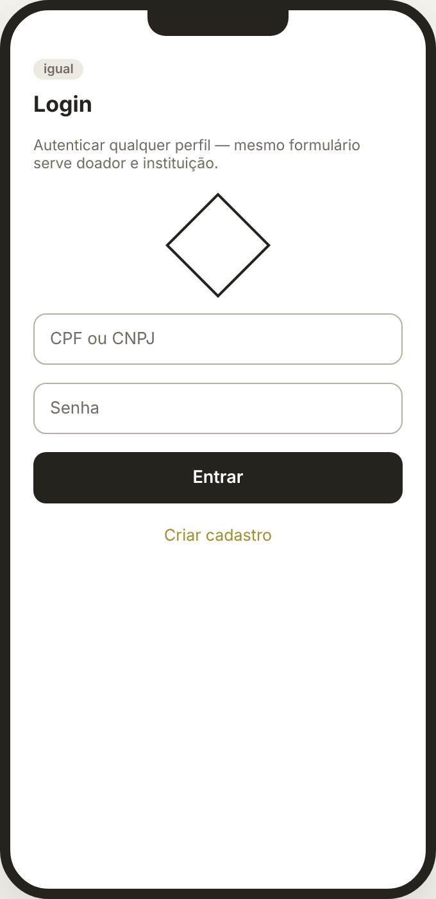
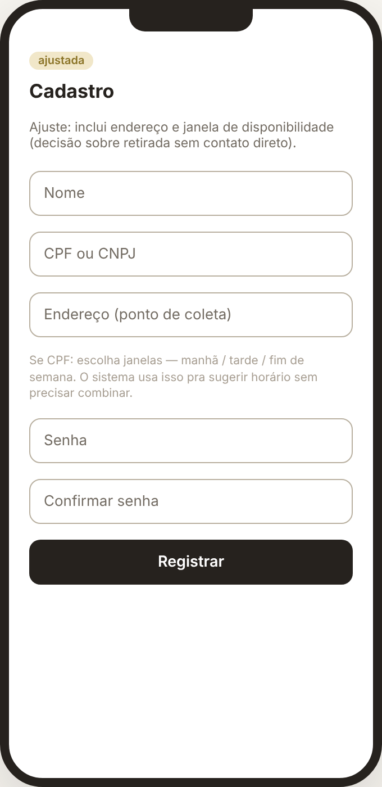

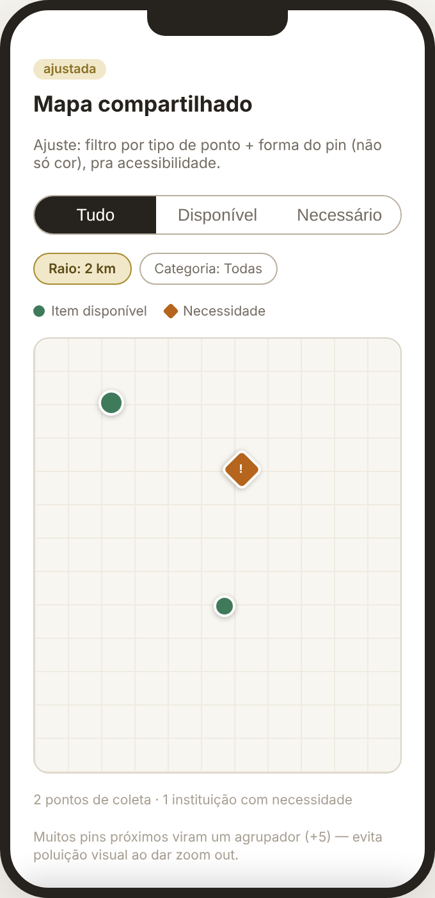
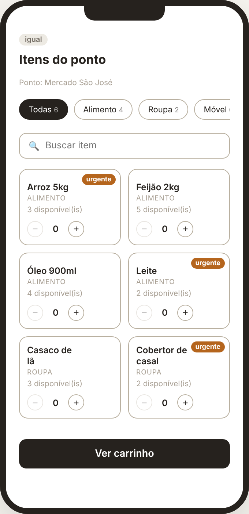

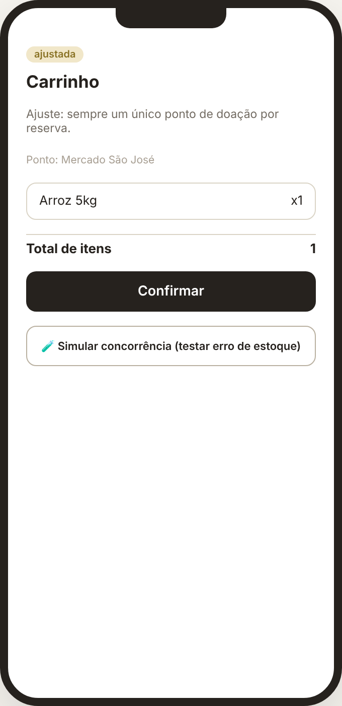
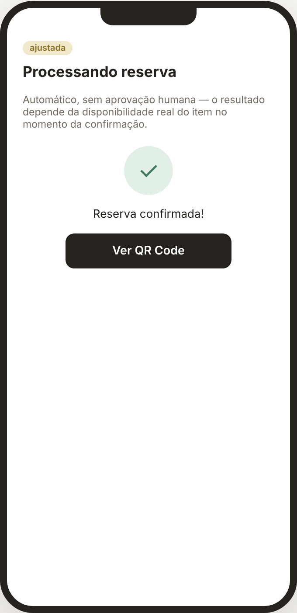
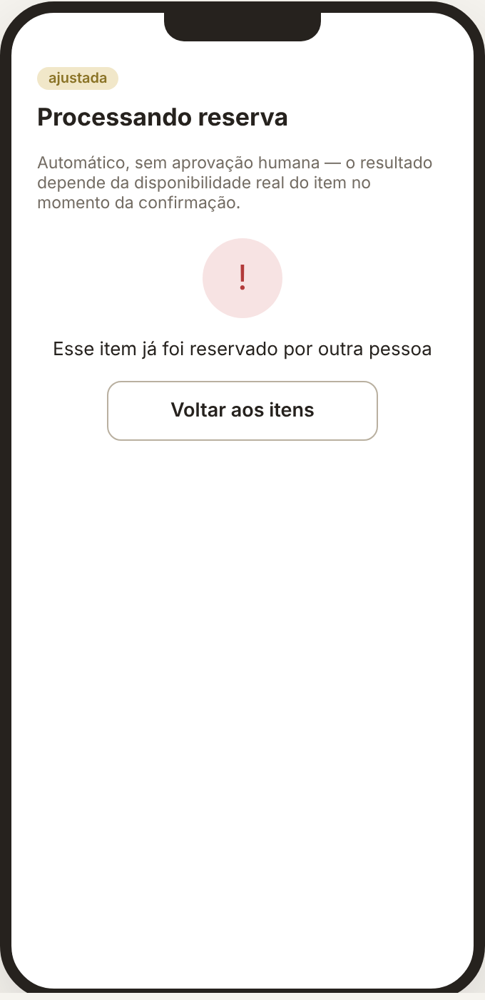
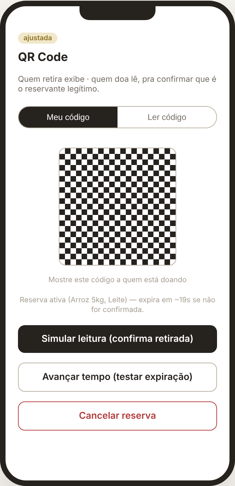
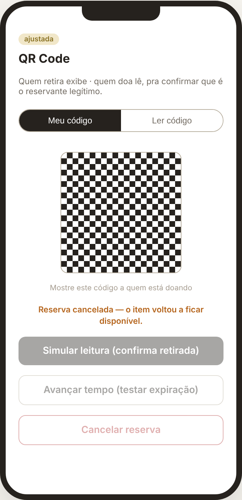
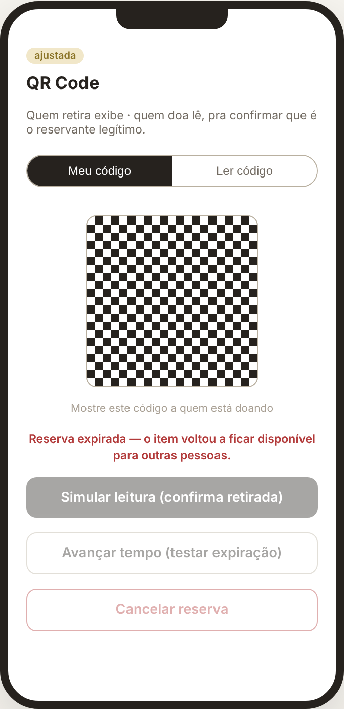
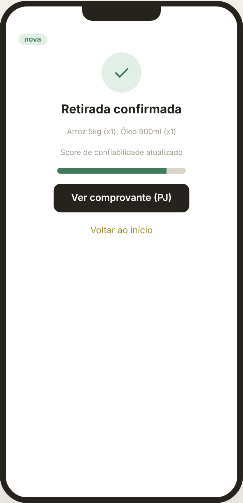
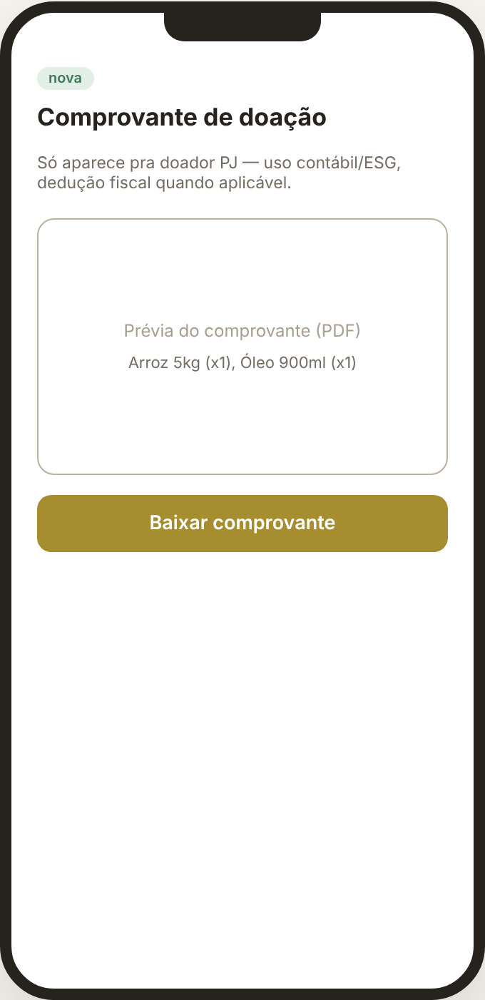
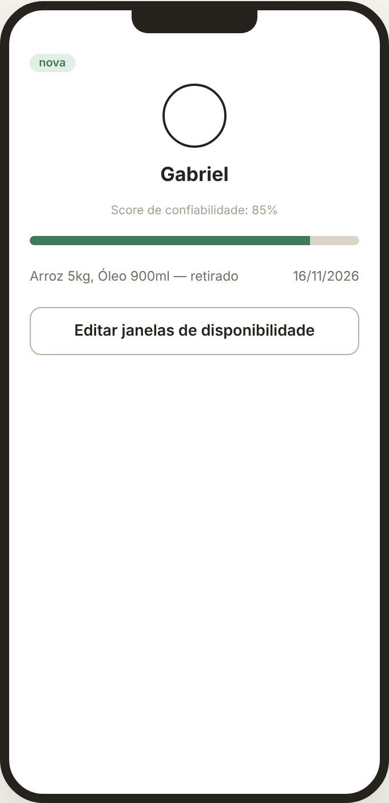
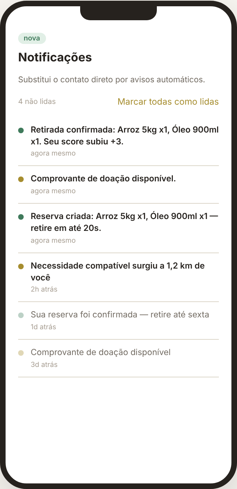
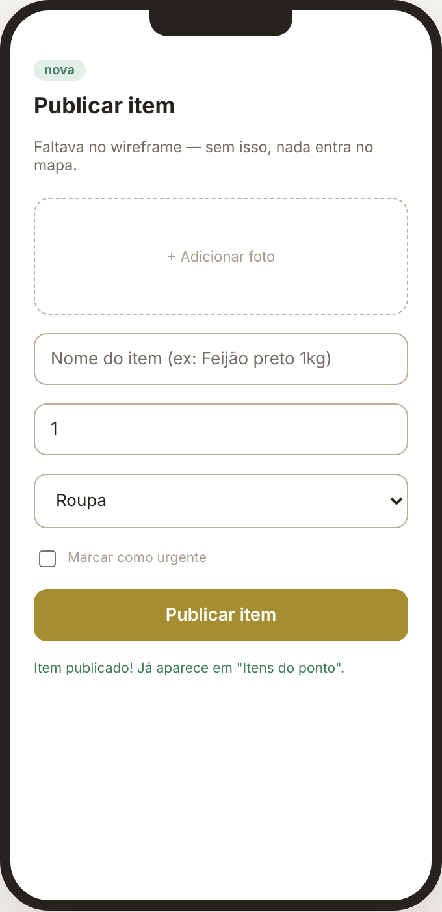
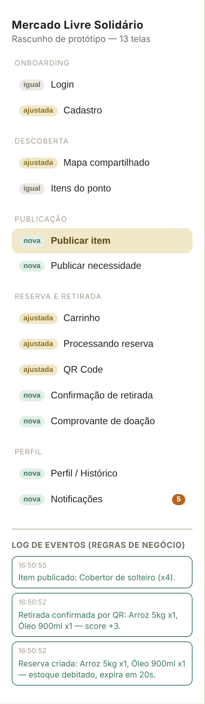

## Limitações conhecidas

- A vitrine de necessidades aparece no mapa (com detalhes da instituição) e aceita
  publicação, mas **não é possível reservar contra uma necessidade**: o botão "Quero doar
  este item" apenas leva ao carrinho. Esse fluxo **está especificado como núcleo do MVP**, mas **não foi implementado no frontend deste pacote**. É uma divergência conhecida, não uma ausência de definição do domínio.
- O **+3 de score por retirada confirmada** é uma regra exploratória herdada e **não faz parte do MVP aprovado**; está em `CONFIG.scorePerConfirmedPickup` (`data.js`). A tela de comprovante/ESG e o QR Code simulado também não são comprovações oficiais.
- Os dados vivem só em memória: ao recarregar a página, voltam ao estado inicial.
- **Não há autenticação, autorização institucional nem verificação real na camada JavaScript**. `publishNeed()` aceita um ID de instituição existente, sem verificar o status de aprovação e sem validar o papel do usuário. Essa lacuna é crítica para a RN-002. Login e cadastro têm campos digitáveis, mas não autenticam nem gravam nada. "+ Adicionar foto",
  "Baixar comprovante" e "Editar janelas de disponibilidade" continuam sem ação (fora do escopo
  de simulação de regras de negócio).
- O filtro de categoria não se aplica às necessidades do frontend (faltam categorias nos dados em memória, embora o modelo PostgreSQL possua categorias de necessidade).
- O botão "Simular concorrência" e o "Avançar tempo" são ferramentas de demonstração.
- Os testes automatizados cobrem regras e estrutura (Node, sem navegador). O visual e os
  cliques foram conferidos num navegador real (Chrome), mas essa conferência não faz parte do
  repositório: rode `node --test` para as regras e abra o `index.html` para ver as telas.

## Stack

HTML5, CSS3 e JavaScript puro (sem frameworks, sem backend e sem etapa de build), por decisão consciente
nesta etapa de prototipagem exploratória (validação do domínio antes de compromisso
com arquitetura definitiva).


## Prova de conceito PostgreSQL (separada do frontend)

Os scripts disponibilizados em `experimentos/postgresql/sql/` são provenientes da experimentação do quarto período; o frontend **não se conecta a eles**. A prova de conceito inclui 11 tabelas, a visão `ms.v_disponibilidade` e funções PL/pgSQL de reserva, cancelamento, expiração, informação de entrega e confirmação institucional. Os cenários SQL documentados no PDF final da equipe devem ser reproduzidos pela equipe para a banca.

Ordem de execução em **banco experimental novo**, usando pgAdmin 4 / PostgreSQL 18:

1. `00_criar_banco.sql`, conectado ao banco administrativo `postgres` (cria o banco `marketplace_solidario`).
2. Conectar-se ao novo banco `marketplace_solidario`.
3. Executar `01_estrutura.sql`, `02_operacoes.sql`, `03_dados_demonstracao.sql` nesta ordem.
4. Executar `04_testes_funcionais.sql` (usa `ROLLBACK` para reverter os cenários).
5. Executar `07_inspecao.sql` para inspeção das tabelas e visões.

**Cuidado:** não repetir os scripts de criação e carga sobre uma base já populada. Os arquivos `05_concorrencia_sessao_A.sql` e `06_concorrencia_sessao_B.sql` são **experimentos opcionais de duas sessões** que podem gravar alterações; utilize somente dados de demonstração e prepare a base antes de repetir.

## Evidências, limites e rastreabilidade

- `docs/screenshots/`: capturas da versão de interface disponibilizada pelo Gabriel.
- `docs/evidencias/frontend-testes-50.txt`: resultado da execução de `node --test` neste pacote de revisão.
- **Recuperado e incluído neste pacote:** a prova de conceito JavaScript independente de reservas de necessidades (`experimentos/reserva-necessidade/need-core.js` e `need-core.test.js`), proveniente do ZIP `Marketplace_Solidario_Fase03_Revisado.zip` fornecido pela equipe. Esses 12 testes são distintos dos 50 testes do frontend atualizado. **A versão do PDF entregue documentou um conjunto anterior de 43 testes, não a suíte atual de 62.**
- **Pendentes neste pacote:** capturas originais das execuções PostgreSQL feitas no computador da equipe. Em `docs/evidencias/historico_fase03/`, encontram-se capturas históricas do conjunto de 43 testes e da prova de conceito de 12 testes. Publicar apenas evidências autênticas, sem divulgar senhas nem dados pessoais.
- O mapa do protótipo usa coordenadas e distâncias **pré-configuradas no `data.js`**; não integra serviço de geolocalização real.

Leia também [`docs/REVISAO_PARA_BANCA.md`](docs/REVISAO_PARA_BANCA.md).
