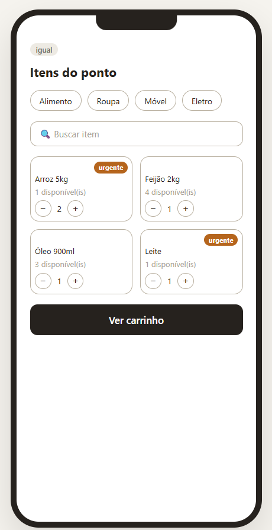
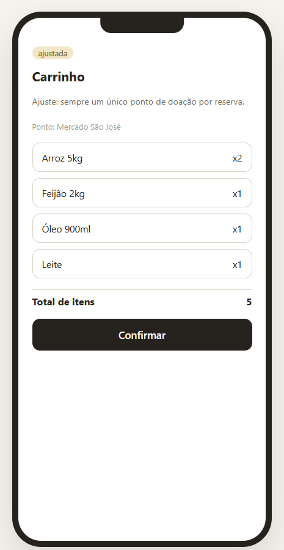
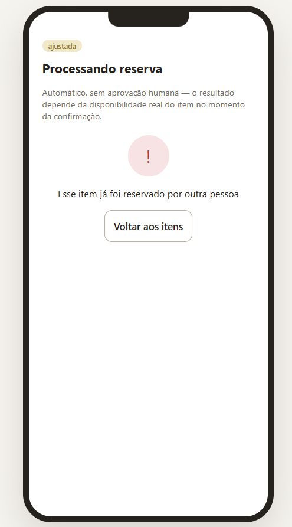
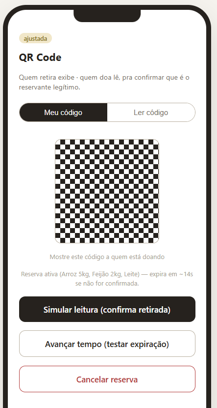
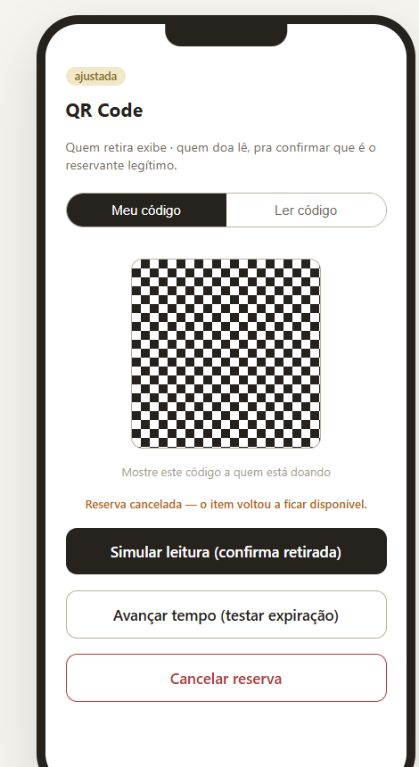
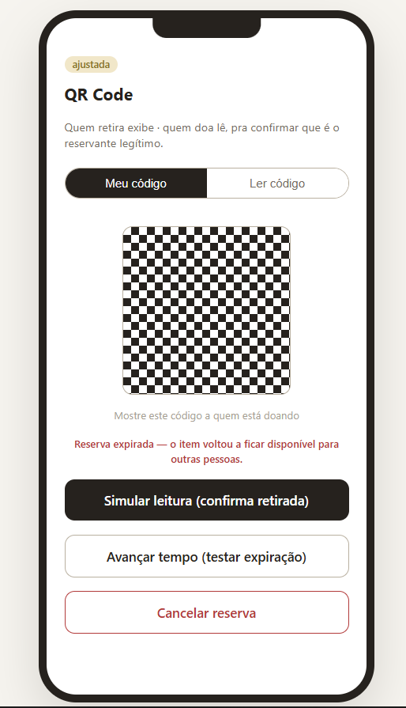
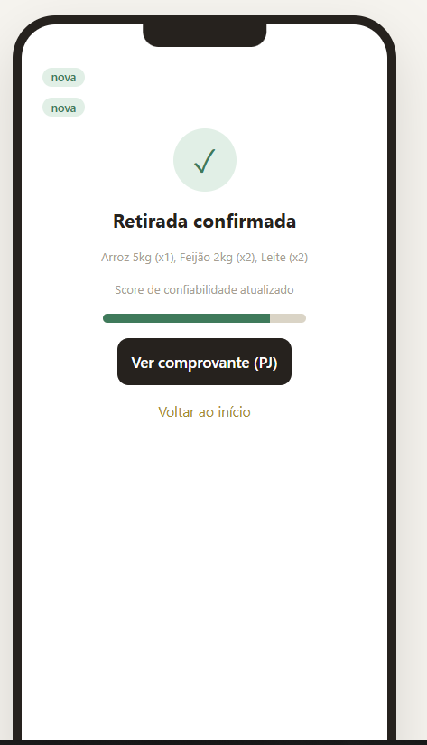
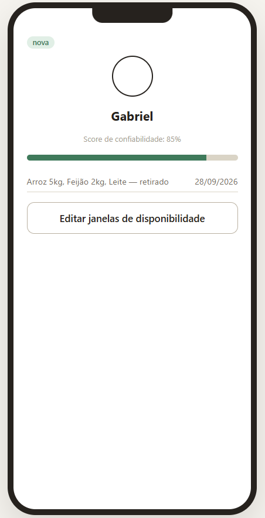
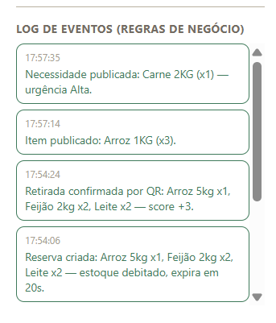

# Marketplace Solidário — Protótipo Funcional

Protótipo clicável (HTML + CSS + JS puro, sem backend) do **Marketplace Solidário**,
um marketplace de solidariedade que conecta doadores (pessoas físicas, empresas e
comércios com excedentes) a instituições receptoras (ONGs, igrejas, abrigos, creches).

Este protótipo já simula, em memória, as regras de negócio centrais do produto —
não é só um mockup clicável de tela em tela.

## Como rodar

Não precisa de instalação nem servidor.

1. Baixe o arquivo `prototipo_Marketplace_Solidario.html` deste repositório.
2. Abra ele diretamente no navegador (duplo clique, ou arraste pro Chrome/Edge/Firefox).

Também dá pra acessar a versão publicada direto no link: *(adicionar aqui o link do
Claude Artifact ou de um GitHub Pages, se for publicar)*.

## O que o protótipo simula de verdade

Diferente de um protótipo "de vitrine" (onde cada tela é fixa e os botões só trocam
de tela), este tem um pequeno **motor de estado em JavaScript** que aplica as regras
de negócio (RN-008 a RN-021) de fato:

| Regra | Como está simulada |
|---|---|
| Disponibilidade | Cada item tem estoque real; o carrinho não deixa reservar mais do que existe |
| Reserva | Ao confirmar, o estoque é debitado de verdade (e checado de novo no momento da confirmação, simulando concorrência) |
| Expiração | Cada reserva tem uma janela de 20s (ajustável no código); passado esse tempo, o estoque volta automaticamente |
| Cancelamento | O doador/instituição pode cancelar antes da confirmação; o estoque volta na hora |
| Confirmação | A leitura do QR Code fecha a reserva, atualiza o histórico e o score de confiabilidade do perfil |
| Publicação | Publicar um item ou uma necessidade insere de fato um novo registro no estoque/vitrine compartilhados |

Toda vez que uma dessas regras é disparada, um **log de eventos com timestamp**
(barra lateral esquerda) registra o que aconteceu — pensado para servir de evidência
de teste (cenário → resultado obtido) e para tirar prints.

## Telas do protótipo (13)

| Bloco | Tela | Status |
|---|---|---|
| Onboarding | Login | Igual ao fluxo original |
| Onboarding | Cadastro | Ajustada |
| Descoberta | Mapa compartilhado | Ajustada |
| Descoberta | Itens do ponto | Dinâmica — estoque real |
| Publicação | Publicar item | Nova — formulário funcional |
| Publicação | Publicar necessidade | Nova — formulário funcional |
| Reserva e retirada | Carrinho | Dinâmico — reflete o estado real |
| Reserva e retirada | Processando reserva | Resultado depende do estoque real |
| Reserva e retirada | QR Code | Confirmar / cancelar / expirar de verdade |
| Reserva e retirada | Confirmação de retirada | Mostra os itens realmente confirmados |
| — | Comprovante de doação (PJ) | Mostra os itens realmente confirmados |
| — | Perfil | Score e histórico reais, atualizados a cada confirmação |
| — | Notificações | Estático (fora do escopo desta rodada) |

## Roteiro sugerido de teste (para a documentação de experimentações — Seção 19.2)

1. Vá em **Itens do ponto** → adicione itens ao carrinho com os botões `+`/`−`.
2. Vá em **Carrinho** → confirme a reserva. Veja o log registrar "Reserva criada".
3. Tente reservar o mesmo item além do estoque disponível → veja o erro real na tela de
   processamento e no log.
4. Na tela de **QR Code**, teste os três desfechos possíveis de uma reserva pendente:
   - **Cancelar reserva** → estoque volta na hora.
   - **Avançar tempo** → simula a expiração (também acontece sozinho após 20s reais).
   - **Simular leitura** → confirma a retirada de verdade.
5. Veja o **Perfil** atualizar o histórico e o score depois de uma confirmação.
6. Publique um item novo ou uma necessidade nova e veja aparecer no estoque/vitrine.

Cada uma dessas ações já vira uma linha no log de eventos, com hora exata — pronta para
preencher cenário / resultado esperado / resultado obtido.

## Screenshots

*(Tire os prints a partir do roteiro acima e salve em `docs/screenshots/`, com estes
nomes, para os links abaixo funcionarem automaticamente.)*

| Tela/estado | Print |
|---|---|
| Itens do ponto (estoque real) | `docs/screenshots/itens.png` |
| Carrinho | `docs/screenshots/carrinho.png` |
| Erro por falta de estoque | `docs/screenshots/erro-estoque.png` |
| QR Code — reserva ativa | `docs/screenshots/qr-ativo.png` |
| QR Code — cancelamento | `docs/screenshots/qr-cancelado.png` |
| QR Code — expiração | `docs/screenshots/qr-expirado.png` |
| Confirmação de retirada | `docs/screenshots/confirmacao.png` |
| Perfil (score + histórico) | `docs/screenshots/perfil.png` |
| Log de eventos (barra lateral) | `docs/screenshots/log-eventos.png` |

```md









```

## Limitações conhecidas (próximos passos técnicos)

- Os pins do mapa ainda não têm a diferenciação por forma/urgência definida na
  arquitetura (círculo = item disponível, losango = necessidade, tamanho por urgência).
- A vitrine de necessidades já aceita publicação, mas ainda não é possível *reservar
  contra uma necessidade* — o fluxo de "seleção guiada por urgência" ainda não é
  jogável de ponta a ponta.
- Existe apenas um ponto de doação simulado ("Mercado São José").
- Login e cadastro permanecem estáticos (fora do escopo de simulação de regras de
  negócio).

## Stack

HTML5, CSS3 e JavaScript puro — sem frameworks e sem backend, por decisão consciente
nesta etapa de prototipagem exploratória (validação do domínio antes de compromisso
com arquitetura definitiva).
