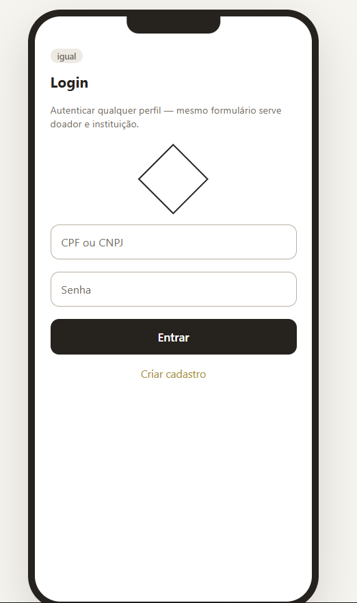
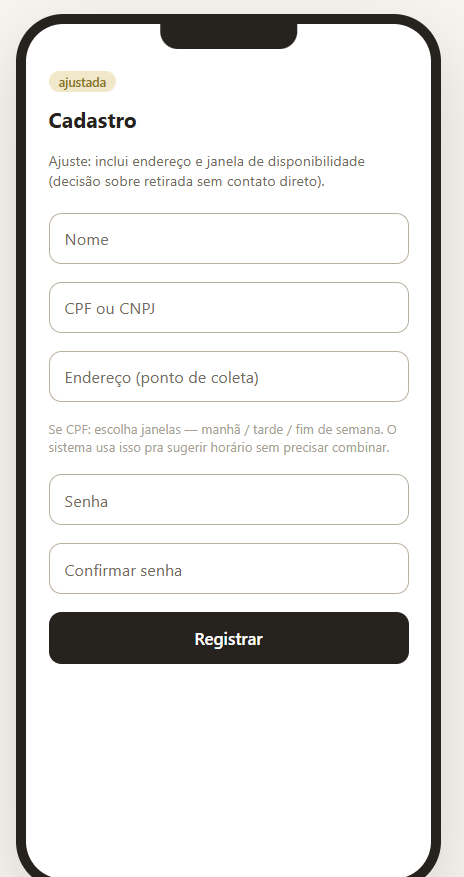
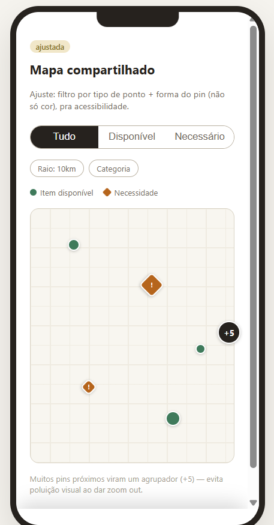
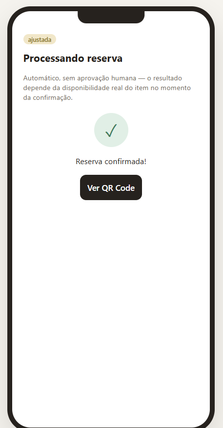
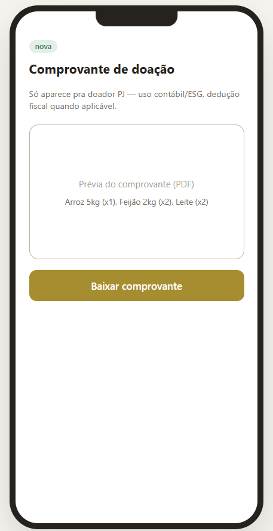
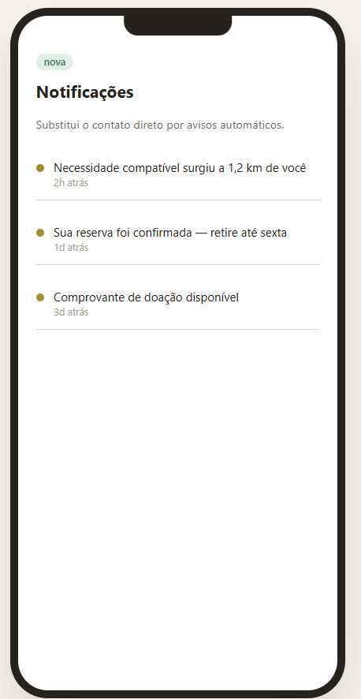
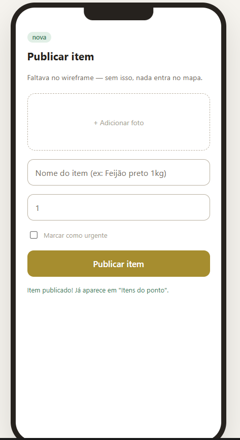

# Mercado Livre Solidário — Protótipo Funcional

Protótipo clicável (HTML + CSS + JS puro, sem backend) do **Mercado Livre Solidário**,
um marketplace de solidariedade que conecta doadores (pessoas físicas, empresas e
comércios com excedentes) a instituições receptoras (ONGs, igrejas, abrigos, creches).

Este protótipo já simula, em memória, as regras de negócio centrais do produto —
não é só um mockup clicável de tela em tela.

## Como rodar

Não precisa de instalação nem de servidor: os scripts são clássicos (sem módulos ES).

1. Baixe/clone este repositório mantendo os arquivos na mesma pasta.
2. Abra o `index.html` no navegador (duplo clique, ou arraste para o Chrome/Edge/Firefox).

## Como rodar os testes

Requer apenas o **Node.js 18 ou superior** (usa o executor de testes nativo; não há
dependências para instalar):

```
node --test
```

ou `npm test`. Os testes não precisam de navegador.

## Arquitetura (camadas)

```
index.html   estrutura das 13 telas        ┐
style.css    visual                         ├─ APRESENTAÇÃO
ui.js        renderização, navegação,       │
             eventos da tela e log          ┘
                │  chama operações / lê dados
                ▼
state.js     estado central + regras de negócio (sem DOM, sem render, sem log)
                ▲  recebe cópias dos dados
data.js      CONFIG (parâmetros) e SEED (dados de demonstração) — só valores
```

- **Fluxo:** clique → `ui.js` chama uma operação do `store` → o `store` valida, altera o
  estado e **emite um evento** → `ui.js` reage (redesenha a tela e escreve no log).
  O `state.js` nunca chama a interface.
- **Contrato das operações:** devolvem `{ ok: true, ... }` ou `{ ok: false, code, message }`.
- **Sem `onclick` inline:** o HTML usa `data-action="..."` e um único *listener* em `ui.js`.
- **Mapa e vitrine** são desenhados a partir dos mesmos dados (pontos, instituições, itens
  e necessidades): esgotar o estoque de um ponto remove o pin dele; publicar uma necessidade
  atualiza o pin da instituição.
- **Score e histórico** do perfil são *derivados* das reservas confirmadas, não copiados.
- **Dados vs. configuração:** `data.js` separa parâmetros (`CONFIG`: prazo de expiração,
  pontos por retirada, tamanhos de pin...) dos dados de demonstração (`SEED`).
- **Futura integração com backend:** cada operação do `store` vira uma chamada de API com
  o mesmo contrato de retorno; a interface não precisaria mudar.

## O que o protótipo simula de verdade

Diferente de um protótipo "de vitrine" (onde cada tela é fixa e os botões só trocam
de tela), este tem um pequeno **motor de estado em JavaScript** que aplica as regras
de negócio (RN-008 a RN-021) de fato:

| Regra | Como está simulada |
|---|---|
| Disponibilidade | Cada item tem estoque real; o carrinho não deixa reservar mais do que existe |
| Reserva | Ao confirmar, o estoque é debitado de verdade (e checado de novo no momento da confirmação, simulando concorrência) |
| Expiração | Cada reserva tem uma janela de 20s (ajustável no código); passado esse tempo, o estoque volta automaticamente |
| Cancelamento | O doador/instituição pode cancelar antes da confirmação; o estoque volta na hora |
| Confirmação | A leitura do QR Code fecha a reserva, atualiza o histórico e o score de confiabilidade do perfil |
| Publicação | Publicar um item ou uma necessidade insere de fato um novo registro no estoque/vitrine compartilhados |

Toda vez que uma dessas regras é disparada, um **log de eventos com timestamp**
(barra lateral esquerda) registra o que aconteceu — pensado para servir de evidência
de teste (cenário → resultado obtido) e para tirar prints.

## Telas do protótipo (13)

| Bloco | Tela | Status |
|---|---|---|
| Onboarding | Login | Igual ao fluxo original |
| Onboarding | Cadastro | Ajustada |
| Descoberta | Mapa compartilhado | Ajustada — pins gerados a partir dos dados |
| Descoberta | Itens do ponto | Dinâmica — itens do ponto selecionado no mapa |
| Publicação | Publicar item | Nova — formulário funcional |
| Publicação | Publicar necessidade | Nova — formulário funcional |
| Reserva e retirada | Carrinho | Dinâmico — reflete o estado real |
| Reserva e retirada | Processando reserva | Resultado depende do estoque real |
| Reserva e retirada | QR Code | Confirmar / cancelar / expirar de verdade |
| Reserva e retirada | Confirmação de retirada | Mostra os itens realmente confirmados |
| — | Comprovante de doação (PJ) | Mostra os itens realmente confirmados |
| — | Perfil | Score e histórico reais, atualizados a cada confirmação |
| — | Notificações | Estático (fora do escopo desta rodada) |

## Roteiro sugerido de teste (para a documentação de experimentações — Seção 19.2)

1. Vá em **Itens do ponto** → adicione itens ao carrinho com os botões `+`/`−`.
2. Vá em **Carrinho** → confirme a reserva. Veja o log registrar "Reserva criada".
3. Tente reservar o mesmo item além do estoque disponível → veja o erro real na tela de
   processamento e no log.
4. Na tela de **QR Code**, teste os três desfechos possíveis de uma reserva pendente:
   - **Cancelar reserva** → estoque volta na hora.
   - **Avançar tempo** → simula a expiração (também acontece sozinho após 20s reais).
   - **Simular leitura** → confirma a retirada de verdade.
5. Veja o **Perfil** atualizar o histórico e o score depois de uma confirmação.
6. Publique um item novo ou uma necessidade nova e veja aparecer no estoque/vitrine.

Cada uma dessas ações já vira uma linha no log de eventos, com hora exata — pronta para
preencher cenário / resultado esperado / resultado obtido.

## Screenshots

*(Prints reais do protótipo em execução. Salve os arquivos do pacote `screenshots.zip`
em `docs/screenshots/` na raiz do repositório para os links abaixo funcionarem.)*

| Tela/estado | Print | Status |
|---|---|---|
| Login | `docs/screenshots/login.png` | ✅ |
| Cadastro | `docs/screenshots/cadastro.png` | ✅ |
| Mapa compartilhado | `docs/screenshots/mapa.png` | ✅ |
| Itens do ponto (estoque real) | `docs/screenshots/itens.png` | ✅ |
| Carrinho | `docs/screenshots/carrinho.png` | ✅ |
| Processando reserva (sucesso) | `docs/screenshots/processando-sucesso.png` | ✅ |
| Processando reserva (erro por falta de estoque) | `docs/screenshots/erro-estoque.png` | ✅ |
| QR Code — reserva ativa | `docs/screenshots/qr-ativo.png` | ✅ |
| QR Code — cancelamento | `docs/screenshots/qr-cancelado.png` | ✅ |
| QR Code — expiração | `docs/screenshots/qr-expirado.png` | ✅ |
| Confirmação de retirada | `docs/screenshots/confirmacao.png` | ✅ |
| Comprovante de doação (PJ) | `docs/screenshots/comprovante.png` | ✅ |
| Perfil (score + histórico) | `docs/screenshots/perfil.png` | ✅ |
| Notificações | `docs/screenshots/notificacoes.png` | ✅ |
| Publicar item | `docs/screenshots/publicar-item.png` | ✅ |
| Log de eventos (evidência das regras de negócio) | `docs/screenshots/log-eventos.png` | ✅ |

```md













```

## Limitações conhecidas

- A vitrine de necessidades aparece no mapa (com detalhes da instituição) e aceita
  publicação, mas **não é possível reservar contra uma necessidade**: o botão "Quero doar
  este item" apenas leva ao carrinho. Esse fluxo não foi implementado porque a regra
  não está definida nos materiais do projeto.
- O **+3 de score por retirada confirmada** é uma regra herdada do protótipo e não consta
  nas RN documentadas; está isolada em `CONFIG.scorePerConfirmedPickup` (`data.js`).
- Os dados vivem só em memória: ao recarregar a página, voltam ao estado inicial.
- Login, cadastro, notificações e "Editar janelas de disponibilidade" permanecem
  estáticos (fora do escopo de simulação de regras de negócio).
- O botão "Simular concorrência" e o "Avançar tempo" são ferramentas de demonstração.
- Os testes automatizados cobrem regras e estrutura (Node, sem navegador); a
  renderização visual ainda precisa de conferência manual no navegador.

## Stack

HTML5, CSS3 e JavaScript puro (sem frameworks, sem backend e sem etapa de build), por decisão consciente
nesta etapa de prototipagem exploratória (validação do domínio antes de compromisso
com arquitetura definitiva).
