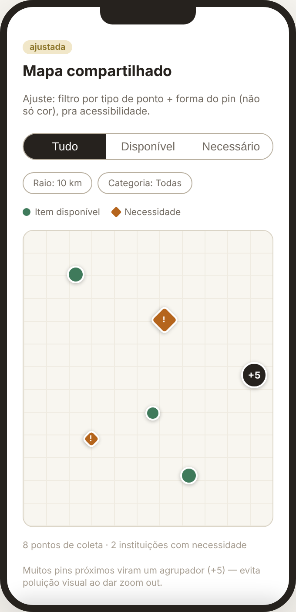
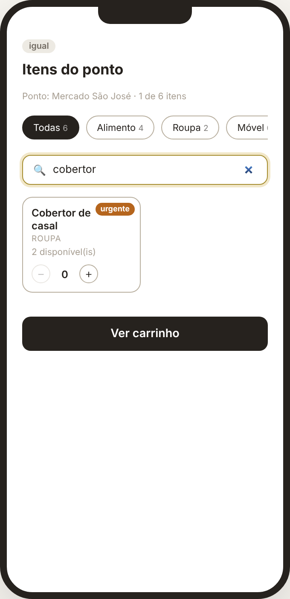

# Marketplace Solidário

Protótipo e experimentações do **Projeto Integrador — Engenharia de Software (4º período, 2026)**.

O Marketplace Solidário propõe aproximar instituições sociais e doadores a partir de necessidades publicadas pelas instituições. O fluxo definido para o produto envolve divulgação de necessidades, reserva de quantidades, informação de entrega pelo doador e confirmação de recebimento pela instituição.

Este repositório registra o trabalho de prototipação e as provas de conceito desenvolvidas no período. **Não se trata de uma aplicação integrada ou pronta para produção.**

## Estado atual

| Componente | O que existe |
| --- | --- |
| Protótipo web | Interfaces em HTML, CSS e JavaScript, com estado mantido em memória. |
| Testes do protótipo | 50 testes automatizados de regras e estrutura. |
| Reserva de necessidades | Prova de conceito independente em JavaScript, com 12 testes. |
| Banco de dados | Prova de conceito no PostgreSQL 18, com 11 tabelas, funções em PL/pgSQL e testes SQL. |
| Integração | O protótipo web **ainda não** está conectado ao PostgreSQL. |

A versão consolidada possui **62 testes JavaScript** (50 do protótipo e 12 da prova de conceito institucional). Os **12 cenários SQL** são outro conjunto de testes, executado separadamente no PostgreSQL.

## Executar o protótipo

Abra `index.html` no Chrome ou Edge. Não é necessário instalar dependências nem executar um servidor para navegar pelas telas.

O protótipo permite explorar o mapa ilustrativo, filtrar e buscar itens, realizar reservas de itens ofertados, simular cancelamento e expiração e acompanhar eventos gerados no estado em memória. Ao atualizar a página, os dados voltam aos valores iniciais.

| Exploração no mapa | Busca de itens |
| --- | --- |
|  |  |

[Ver outras capturas do protótipo](docs/screenshots/)

## Testes em JavaScript

Requer **Node.js 18 ou superior**. Na raiz do repositório:

```bash
# Todos os testes JavaScript
node --test

# Apenas o protótipo web
node --test tests/state.test.js tests/ui.test.js

# Apenas a prova de conceito de necessidades institucionais
node --test experimentos/reserva-necessidade/need-core.test.js
```

No PowerShell do Windows, também é possível usar `npm.cmd test`.

A prova de conceito em `experimentos/reserva-necessidade/` investiga o cálculo de disponibilidade, criação e cancelamento de reservas, expiração, informação de entrega e confirmação institucional. Ela utiliza dados simulados em memória e **não está ligada à interface web**.

A regra quantitativa investigada é:

```text
disponível = solicitado − reservado em operações ativas − recebido confirmado
```

A entrega informada pelo doador ainda compromete a quantidade reservada. O recebimento só passa a ser confirmado após a ação da instituição autorizada.

## Banco de dados — PostgreSQL

Os scripts estão em [`experimentos/postgresql/sql/`](experimentos/postgresql/sql/). A experimentação usa PostgreSQL 18, o banco `marketplace_solidario` e o esquema `ms`.

Em **uma base de demonstração nova**, execute os arquivos nesta ordem:

1. `00_criar_banco.sql`, conectado ao banco administrativo `postgres`.
2. Conecte-se ao banco `marketplace_solidario`.
3. Execute `01_estrutura.sql`, `02_operacoes.sql` e `03_dados_demonstracao.sql`.
4. Execute `04_testes_funcionais.sql` e confira a saída na aba **Messages** do pgAdmin.
5. Use `07_inspecao.sql` para consultar o estado dos dados.

O arquivo de testes funcionais usa transação com `ROLLBACK` para não manter suas alterações de demonstração. Os scripts `05_concorrencia_sessao_A.sql` e `06_concorrencia_sessao_B.sql` são **opcionais** e podem gravar mudanças: execute-os apenas em uma base descartável.

As capturas da execução e os registros dos testes estão reunidos em [`docs/evidencias/`](docs/evidencias/).

## Organização do repositório

```text
index.html                   Interface do protótipo
style.css                    Estilos
ui.js                        Renderização e eventos da interface
state.js                     Estado e operações do protótipo
data.js                      Configurações e dados fictícios
tests/                       Testes do protótipo
experimentos/
  reserva-necessidade/       Prova de conceito JavaScript do fluxo institucional
  postgresql/                Scripts e orientações da prova de conceito SQL
docs/
  screenshots/               Capturas da interface
  evidencias/                Resultados de testes e capturas do pgAdmin
```

## Escopo e próximos passos

O protótipo atual demonstra principalmente **oferta e retirada de itens**. Já o MVP especificado é centrado em **necessidades publicadas por instituições verificadas**. A reserva de uma necessidade está implementada apenas na prova de conceito independente.

Também permanecem fora da implementação atual a autenticação real, a autorização institucional no servidor, a integração frontend–banco de dados e os testes de concorrência de ponta a ponta. O mapa utiliza dados locais de demonstração, sem serviço externo de geolocalização.

Para as próximas etapas, a equipe pretende estudar **React Native** para uma experiência prioritariamente mobile e definir a API que conectará a aplicação ao PostgreSQL. Essas tecnologias e integrações futuras não devem ser confundidas com funcionalidades já concluídas.

---

**Equipe:** Nicolas, Gabriel, Carlos e Arthur.  
**Contexto:** Projeto Integrador, 4º período — 2026.
